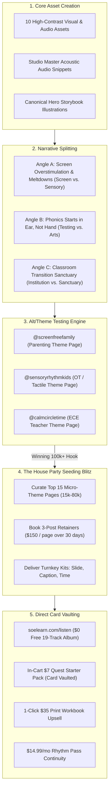

# 🚀 SOE Def Jam Viral Seeding & Narrative Engineering Playbook
**The Sound of Essentials: Rhythm Quest · Ex-Def Jam Curation & Seeding Engine**
*Adapted from Jacorey Barkley (Ex-Def Jam Marketer, No Labels) — One More Time #287*

---

## ⚡ Executive Summary: The Shift from "Promo" to Narrative Seeding

Traditional music marketing relies on "hope and prayer" or burning tens of thousands of dollars on single celebrity influencers who deliver unpredictable engagement.

This playbook operationalizes the **Def Jam / Modern Indie Seeding Engine**:
1. **Never Sell Music; Sell Emotional Stories**: Music alone does not go viral. Music that soundtracks an urgent, emotionally charged narrative (meltdowns, healing, screen addiction, parental guilt, sensory peace) commands viral distribution.
2. **The "House Party" Frequency Effect**: Audiences skip one-off promo posts. When an audience sees the same project featured on the same community page **3 to 5 times over 30 days**, the psychological boundary blurs between "sponsored ad" and "cultural movement."
3. **The Micro-Curator Arbitrage ($30–$60/post)**: Avoid $10k+ celebrity influencers. The highest ROAS lives in micro-theme pages (15k–80k followers in gentle parenting, Montessori, homeschool, and sensory regulation) managed by independent creators eager for $30–$60 per post or $150 for 3-post retainers.
4. **The Alt/Theme Account Volume Multiplier**: Run 2–3 niche theme accounts in-house. Take **10 core assets** $\times$ **3 distinct narrative angles** $\times$ **3 distribution profiles** = **90 testing touchpoints** without spamming the primary brand or fatiguing followers.
5. **The Backend Ecosystem Imperative**: Streaming pennies ($0.003/stream) are irrelevant. The 19 master acoustic tracks are the **$0 Trojan Horse** that drives the **$7 Quest Starter Pack** in-cart bump to vault the parent's credit card, immediately triggering post-purchase conversions for the **$35 Rhythm Ready print workbook** and **$14.99/mo Rhythm Pass**.

---

## 1. The 5 Operational Pillars



---

## 2. The "House Party" Frequency Model (30-Day Retainer)

Jacorey Barkley’s central insight:
> *"When you walk into a house party where you don't know anybody, people are suspicious. The first time you get posted on a page, followers say 'skip, paid promo.' But when they see you on that page three, four, five times, the line blurs between 'is this paid promo or does this page genuinely think I should pay attention to this?'"*

### The 30-Day Deployment Cadence for a Target Page:

| Week | Post Format | Tactical Angle | Goal |
| :--- | :--- | :--- | :--- |
| **Week 1** | Carousel (Educational / High Friction) | *"The bedtime sensory spike: Why fast-tempo nursery rhymes trigger toddler cortisol."* | Establish authority; introduce the problem without pitching. |
| **Week 2** | Audio Reel + Tactile Demonstration | *The 90-second sensory reset: Watch 4-year-olds breathe and tap with Terrasol.* | Tangible proof of acoustic co-regulation; comment engagement. |
| **Week 3** | Hero Storybook Showcase | *The story of Seriphia: Teaching early phonics through rhythm quests, not worksheets.* | Brand recognition; introduce characters and visual world. |
| **Week 4** | Direct Lead Gift Carousel | *Grab the complete 19-track acoustic album free for your morning/bedtime routine.* | Conversion to `soelearn.com/listen`; card-vaulting activation. |

---

## 3. The 90-Post Alt / Theme Account Testing Matrix

Before paying external pages to seed content, test hooks on **in-house niche theme pages**.

### The Math:
- **10 Core Video/Visual Assets** (Children tapping, studio session footage, Seriphia storybook flip, tactile pencil grip on workbook).
- **3 Narrative Angles** (Screen Overstimulation, Ear-Before-Eye Phonics, Classroom Co-Regulation).
- **3 Theme Accounts** = **90 unique published posts** across 30 days.

```
Asset #1: Parent & Child Rhythmic Tapping
├─ Angle A (@screenfreefamily): "What we do when the 5 PM screen meltdown starts."
├─ Angle B (@sensoryrhythmkids): "Bilateral motor coordination before pencil grip."
└─ Angle C (@calmcircletime): "How to transition 18 toddlers to naptime in 2 minutes."
```

When an angle clears **50k+ views or a 5%+ save rate** organically, that exact creative and caption is packaged into a Turnkey Seeding Kit and sent to paid curation pages.

---

## 4. Turnkey Seeding Delivery Standard

Established curation accounts will ignore vague pitches. They require **turnkey delivery** so the page admin can schedule the post in under 60 seconds:

Every Seeding Delivery Kit **MUST** include:
1. **Headline (Slide 1 Hook)**: High-contrast text overlay on 1080x1350 vertical canvas.
2. **Slide Sequence (Slides 2–5)**: 
   - Slide 2: The Core Friction / Problem.
   - Slide 3: The Neurological / Tactile Solution.
   - Slide 4: Real-life demonstration or Hero story scene.
   - Slide 5: Clean CTA with arrow pointing to bio link.
3. **Exact Verbatim Caption**: Pre-formatted with hook, line breaks, story copy, and 5 targeted hashtags.
4. **Scheduled Posting Window**: Exact day of the week and local timezone (e.g., *Sunday, 7:30 PM EST*).
5. **Bio Link Asset**: Tracked shortlink redirecting to `https://soelearn.com/listen?utm_source=seeding&utm_medium=theme_page&utm_campaign=[PAGE_NAME]`.

---

## 5. Micro-Curator DM Outreach & Negotiation Scripts

### The Initial DM (Instagram / TikTok):
```text
Hey [Name]! Love what you’ve built with [Account Name]—your post last Tuesday on toddler sensory overload was spot on.

We have a finished 4-slide carousel on how acoustic studio rhythm calms bedtime meltdowns in under 90 seconds (100% screen-free, beautiful storybook aesthetic).

We provide everything ready-to-post: slides, caption, and scheduled time.

Would love to feature this on your page this month. Do you offer a 3-post package across 30 days? What’s your rate?
```

### The Fast-Close Negotiation (Target: $30–$60 single / $150 package):
- If they ask for $100 single post:  
  *“We love your community and want to build a long-term relationship. Could we do $150 for a 3-post sequence across the next 4 weeks ($50/post)? We pay upfront via PayPal/Stripe and deliver all assets pre-formatted.”*
- If they ask what we do:  
  *“We build screen-free acoustic music and storybook curricula for ages 2–7—created with a father's heart and a mother's love to replace frantic screen time. Zero corporate fluff.”*

---

## 6. Strict Non-Negotiable Invariants

1. **Ages 2–7 Strict Boundary**: All copy and visual references must remain firmly locked to Ages 2–7 (Toddler, Pre-K to Grade 2).
2. **Music Production Contract**: Always state: *originally published master acoustic tracks recorded live in studio sessions*. NEVER state: "live instrumentation", "live orchestra", or "live instruments". Zero invented instruments.
3. **Card-Vaulting Funnel Only**: Direct all traffic to `soelearn.com/listen`. Never send traffic to generic Spotify links. The objective is to vault parent credit cards with the $7 Quest Starter Pack bump.
