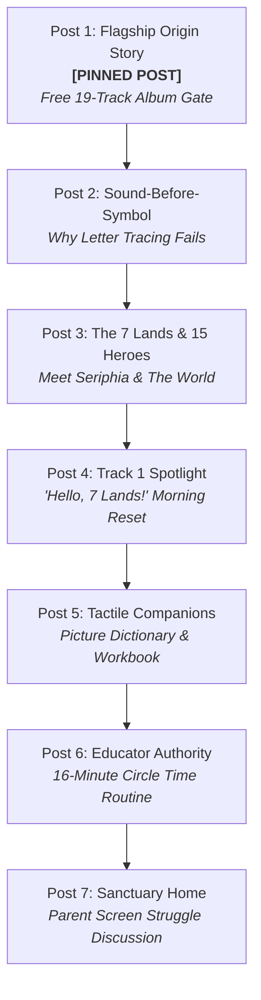

# 📘 SOE Facebook Page Canonical Seeding Guide & Operations Engine
**The Sound of Essentials: Rhythm Quest · Organic Brand Foundation & Launch Matrix**
*Connected Facebook Page ID: `1238685869335542`*

---

## 1. Executive Overview

Before running cold acquisition ads (Meta Ads Manager) or conducting organic outreach in homeschool and ECE parenting groups, the **Facebook Business Page** must be seeded with high-trust, canonical content. A visitor who clicks through to the Facebook profile must immediately perceive an established, loving, authoritative educational sanctuary—not an empty shell.

This blueprint establishes:
1. **Canonical Page Profile Architecture** (Bio, Story/Mission, Action Button, Cover & Profile assets).
2. **7-Post Launch Seeding Sequence** (The foundational content wave covering all 5 Cultural Deltas, 7 Lands, 15 Heroes, and the $0 free 19-track album offer).
3. **Automated Publishing Tool (`tools/seed_facebook_page.py`)** with native multipart local image uploading.
4. **Exported CSV & JSON Catalogs** for Meta Business Suite Planner bulk import.

---

## 2. Page Profile Architecture & Setup

| Setting | Canonical Value | Notes / Placement |
|:---|:---|:---|
| **Page Name** | `The Sound of Essentials: Rhythm Quest` | Official Brand Title |
| **Username / Vanity URL** | `@thesoundofessentials` (or `@soelearn`) | `facebook.com/thesoundofessentials` |
| **Category** | `Early Childhood Education` · `Children's Music & Education` · `Publisher` | Primary + Secondary categories |
| **Action Button (CTA)** | **Listen Now** (or **Sign Up**) | Destination URL: `https://soelearn.com/listen` |
| **Website URL** | `https://soelearn.com` | Primary canonical domain |
| **Profile Picture** | `SOE Logo.png` or `ad04_seriphia_classroom_canon.png` | Seriphia / Golden Emblem (1:1 Square, 800x800px) |
| **Cover Photo / Banner** | `SOE background arc.png` or `ad11_seven_lands_globe_canon.png` | 7 Lands Panoramic (820x312 desktop / 640x360 mobile safe) |

### Page Short Bio (Under 255 Characters)
> Handcrafted, screen-free early learning for ages 2–7. 19 original story songs recorded live in studio sessions, 7 lands, and tactile books. Start with the music. 🎵💛

### Page Story / Long "About" Section
> **Guided by a father's heart and a mother's love.**
> 
> When our children's school cut their music and arts program simply because music wasn't on the standardized testing grid, we knew we couldn't wait for the system to change.
> 
> Music isn't an elective for a 4-year-old—it is the neurological foundation of how their brain learns to count, decode phonics, and calm their nervous system.
> 
> Built over 15 years, **The Sound of Essentials: Rhythm Quest** replaces screen addiction and algorithmic mini-games with an unhurried, whole-hearted learning journey:
> • **19 Originally Published Acoustic Songs** — Master recordings recorded live in studio sessions with authentic human vocals across 7 living lands.
> • **Sound-Before-Symbol Pedagogy** — Anchoring phonetic sounds into the body and ear before asking small hands to trace abstract symbols.
> • **Tactile, Screen-Free Companions** — The 4,232-word Essential Picture Dictionary and 40-Day Rhythm Ready Workbook.
> 
> We are making our complete 19-track album 100% free for families, teachers, and homeschool pods everywhere.
> 
> 🌿 Stream the full album free: https://soelearn.com/listen

---

## 3. The 7-Post Launch Seeding Matrix

All 7 posts are pre-engineered with exact canon copy, verified local visual assets, hashtags, and links to `soelearn.com/listen`.



### Post 1 (FLAGSHIP PINNED POST)
* **Theme:** The Origin Story & Free 19-Track Album Gift
* **Cultural Delta:** Institutional Injustice & Founder Vulnerability
* **Image Asset:** [`ad-origin-story_square.png`](file:///c:/Users/ldmur/Downloads/The%20Sound%20of%20Essentials%20Image%20Assets/ad-origin-story_square.png)
* **Status on Page:** **Pin to Top of Page**

**Post Text:**
> To every parent trying to build a peaceful, screen-free morning routine:
> 
> A while back, I watched my children's school cut their music and arts program. Not because the kids didn't love it, and not because it wasn't working. But simply because music wasn't on the standardized testing grid.
> 
> It broke my heart. Music isn't an elective for a 4-year-old—it's the neurological foundation of how their developing brain learns to count, decode phonics, and regulate their nervous system.
> 
> Guided by a father's heart and a mother's love, we spent years building what the schools took away. We created The Sound of Essentials: Rhythm Quest—19 originally published acoustic songs recorded live in studio sessions with authentic human vocals, covering phonics, math, movement, emotional regulation, and nature across 7 imaginary lands for ages 2–7.
> 
> We decided to make the complete 19-track album 100% free for families everywhere. No subscription, no app download, and zero algorithmic screen traps.
> 
> 👉 Stream and claim the full 19-track album free right now: https://soelearn.com/listen
> 
> May it bring peace, singing, and joy to your mornings!
> 
> #TheSoundOfEssentials #RhythmQuest #ScreenFreeKids #HomeschoolMorning #EarlyLiteracy #CalmParenting

---

### Post 2
* **Theme:** The Sound-Before-Symbol Phonics Breakthrough
* **Cultural Delta:** Screen vs. Sensory
* **Image Asset:** [`auditory_ear_before_print.jpg`](file:///c:/Users/ldmur/Downloads/The%20Sound%20of%20Essentials%20Image%20Assets/auditory_ear_before_print.jpg)

**Post Text:**
> Quick early literacy insight for parents of 3 to 6-year-olds:
> 
> If your child resists tracing letters, avoids flashcards, or melts down over phonics worksheets, it's not because they lack focus. It's because early education often forces 'Symbol-First' learning before the brain is ready.
> 
> In early cognitive development, the ear decodes rhythm, cadence, and syllables months before the eye can comfortably track abstract 2D shapes on a page. When children internalize the pulse of beginning sounds through rhythmic call-and-response echo songs, reading unlocks naturally.
> 
> That's why The Sound of Essentials starts with sound, not screens. Through 19 handcrafted story songs, children hear phonics in their bodies before they ever pick up a pencil.
> 
> Experience the difference with your little one today:
> 👉 Stream all 19 tracks free at https://soelearn.com/listen
> 
> #SoundBeforeSymbol #EarlyLiteracy #MontessoriAtHome #PreschoolReading #ScreenFreeLearning

---

### Post 3
* **Theme:** Welcome to the 7 Lands & 15 Heroes of Rhythm Quest
* **Cultural Delta:** Consumption vs. Quest
* **Image Asset:** [`ad11_seven_lands_globe_canon.png`](file:///c:/Users/ldmur/Downloads/The%20Sound%20of%20Essentials%20Image%20Assets/ad11_seven_lands_globe_canon.png)

**Post Text:**
> Step outside the algorithmic rabbit holes and step into a continuous story world.
> 
> Under the guidance of Seriphia, Guardian of the Sound, your child journeys through 7 musical lands designed specifically for ages 2–7 (Pre-K to Grade 2):
> 
> 🌸 Harmonia (Kenji & Aiko) — Beginning phonics, rhythm echo, and polite manners
> 🔢 Numeria (Kwame & Octavia) — 1–20 rhythmic counting, patterns, and geometric shapes
> ⚡ Vitalis (Felix & Amara) — Cross-body motor coordination, somatic movement, and healthy nutrition
> ⭐ Celestia (Elias & Selene) — Solar observation, passage of time, and wonder of the cosmos
> 💡 Luminosity (Athena & Ezra) — Bilingual French songs, inquisitive science, and light
> 🌊 Aquaria (Nerissa & Ronan) — Calming breathing tempos, water stewardship, and emotional regulation
> 🌿 Terrasol (Vesta & Silas) — Four seasons, animal tracking, and connection to the living earth
> 
> No bright pings. No addictive variable rewards. Just beautiful music and wholesome mentors.
> 
> 👉 Start your quest free today: https://soelearn.com/listen
> 
> #RhythmQuest #7Lands #CharacterEducation #WholesomeKids #ScreenFreeChildhood

---

### Post 4
* **Theme:** Track Spotlight: Hello, 7 Lands! (Track 1) & Morning Reset
* **Cultural Delta:** Testing vs. Arts
* **Image Asset:** [`The Sound of Essentials album cover.png`](file:///c:/Users/ldmur/Downloads/The%20Sound%20of%20Essentials%20Image%20Assets/The%20Sound%20of%20Essentials%20album%20cover.png)

**Post Text:**
> Tired of morning overwhelm, rushed breakfast tables, and screen negotiations?
> 
> Here is a simple 3-minute shift: Press play on Track 1 of Rhythm Quest ('Hello, 7 Lands!') while pouring breakfast.
> 
> Recorded live in studio sessions with authentic human vocals and warm acoustic arrangements, this opening track sets an unhurried, neuro-affirming tempo that gently wakes up developing nervous systems.
> 
> Children instinctively start swaying, humming along, and centering their focus—no shouting, no screen bargaining.
> 
> Try it in your kitchen or classroom tomorrow morning:
> 👉 Stream the entire 19-track album free: https://soelearn.com/listen
> 
> #MorningRoutine #PreschoolCircleTime #CalmMornings #KidsMusic #SensoryFriendly

---

### Post 5
* **Theme:** Tactile Companions: Picture Dictionary & Workbook
* **Cultural Delta:** Algorithm vs. Handcrafted
* **Image Asset:** [`rhythm-ready-workbook-cover.png`](file:///c:/Users/ldmur/Downloads/The%20Sound%20of%20Essentials%20Image%20Assets/rhythm-ready-workbook-cover.png)

**Post Text:**
> What happens when the music stops?
> 
> That's when little fingers turn the page. The Sound of Essentials ecosystem pairs our 19 acoustic songs with tactile, screen-free physical tools:
> 
> 📖 The Essential Picture Dictionary — 4,232 rich vocabulary words across 157 illustrated storybook scenes. Children search, point, and name real objects without a single blue-light pixel.
> 
> ✏️ The 40-Day Rhythm Ready Workbook — 10 daily micro-blocks (just 15–20 minutes/day) featuring rhyming games, rhythmic clapping, tracing paths, and nature observations.
> 
> When songs and real paper meet, literacy isn't a chore—it becomes their favorite part of the day.
> 
> Explore our tactile learning companions:
> 👉 Discover the physical collection: https://soelearn.com/shop
> 👉 (And stream all 19 songs free at https://soelearn.com/listen)
> 
> #PictureDictionary #HandsOnLearning #TactileLearning #CharlotteMasonHomeschool #MontessoriBooks

---

### Post 6
* **Theme:** Educator & Classroom Authority: The 16-Minute Daily Rhythm
* **Cultural Delta:** Institution vs. Sanctuary
* **Image Asset:** [`ad04_seriphia_classroom_canon.png`](file:///c:/Users/ldmur/Downloads/The%20Sound%20of%20Essentials%20Image%20Assets/ad04_seriphia_classroom_canon.png)

**Post Text:**
> To our early childhood educators and homeschool directors:
> 
> Finding circle time resources that don't overstimulate little nervous systems is an everyday challenge. Commercial cartoon music is often high-pitched, frenetic, and sensory-jarring.
> 
> Here is the 16-minute micro-block routine educators are using across the country:
> 1️⃣ Word Detectives (3 min): Phonics echo song in Harmonia
> 2️⃣ Number Hunt (3 min): Rhythmic counting claps 1–20 in Numeria
> 3️⃣ Garden Secrets (3 min): Nature inquiry & weather observation
> 4️⃣ Wake-Up Movement (4 min): Somatic stretching in Vitalis
> 5️⃣ Calming Reflection (3 min): Breathing tempo in Aquaria
> 
> Total time: 16 calm, focused minutes. Children are grounded, engaged, and ready to learn.
> 
> We provide the entire 19-track album 100% free for classroom streaming (no paywall):
> 👉 Stream free for your classroom: https://soelearn.com/listen
> 
> #ECE #PreKTeacher #KindergartenTeacher #CircleTime #ClassroomManagement #SensoryDiet

---

### Post 7
* **Theme:** Parent Discussion & Community Sanctuary
* **Cultural Delta:** Sanctuary Home & Community Engagement
* **Image Asset:** [`hero_sanctuary_home.jpg`](file:///c:/Users/ldmur/Downloads/The%20Sound%20of%20Essentials%20Image%20Assets/hero_sanctuary_home.jpg)

**Post Text:**
> Be honest: How many times this week did a 'quick 15-minute educational video' turn into a full meltdown when it was time to turn it off?
> 
> You are not alone. And it is NOT your fault.
> 
> Modern children's media is engineered by attention economists using variable dopamine loops. When kids watch them, their bodies enter a fight-or-flight freeze. The meltdown isn't defiance—it's their nervous system trying to regulate after extreme sensory stimulation.
> 
> In our home, replacing screens with story-driven acoustic music changed everything. The room goes quiet. Imagination takes over. And when the song finishes, they're calm—not rattling.
> 
> 💬 Drop a comment below: What has been your family's biggest win (or biggest hurdle) in reducing screen time?
> 
> If you need a gentle reset this evening, our 19-track learning album is waiting for you free:
> 👉 Stream free: https://soelearn.com/listen
> 
> #SanctuaryHome #MindfulParenting #GentleParenting #ScreenFreeParenting #PeacefulHome

---

## 4. Automation CLI Guide (`seed_facebook_page.py`)

The automated script supports dry-run testing, single-post posting, full 7-post batch execution, and token validation.

```bash
# In The-Sound-of-Essentials-Eco-System directory:

# 1. Run dry-run validation (verifies all 7 images and formats copy):
python tools/seed_facebook_page.py --publish --dry-run

# 2. Check current token status:
python tools/seed_facebook_page.py --status

# 3. Publish with a fresh token passed directly via CLI:
python tools/seed_facebook_page.py --token "EAAB..." --publish

# 4. Or publish an individual post (e.g. Post 1):
python tools/seed_facebook_page.py --token "EAAB..." --publish-single 1
```

---

## 5. Quick Meta Access Token Refresh (2 Minutes)

Because temporary Meta user tokens expire (the current token expired today at 01:00 PDT), here is the 2-minute step to refresh:

1. Navigate to **[Meta Graph API Explorer](https://developers.facebook.com/tools/explorer/)**.
2. Top-right dropdowns:
   - **Meta App:** Select your connected app.
   - **User or Page:** Select **`The Sound of Essentials`** (Page ID: `1238685869335542`).
3. Under **Permissions**, verify:
   - `pages_show_list`
   - `pages_read_engagement`
   - `pages_manage_posts`
4. Click **Generate Access Token**.
5. Copy the generated token and execute:
   ```bash
   python tools/seed_facebook_page.py --token YOUR_TOKEN --publish
   ```
   *(Or paste it into `META_PAGE_ACCESS_TOKEN` in `.env`)*
